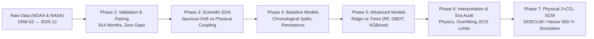

# Climate Sensitivity & Global Temperature Prediction with Machine Learning
**Empirical Investigation of Atmospheric $\text{CO}_2$ Radiative Forcing and Global Temperature Anomalies (1958–2025) Coupled with 1D Ocean Diffusion Physical Climate Modeling**

[](https://www.python.org/downloads/)
[]()
[]()
[]()

---

## 1. Executive Summary & Key Scientific Findings

This project investigates whether historical observations of atmospheric carbon dioxide ($\text{CO}_2$) from the **NOAA Global Monitoring Laboratory (Mauna Loa Observatory)** and global mean surface temperature anomalies from **NASA GISS (GISTEMP v4)** can be paired to predict future global temperature anomalies using statistical and machine learning models, and contrasts empirical ML against physical simple climate models (SCMs).



### Major Findings:
1. **The Spurious Correlation Trap (Granger–Newbold Risk):**
   - The raw bivariate correlation between $\text{CO}_2$ concentration and global temperature anomaly is deceptively high (**$r = 0.9278$**, $\rho = 0.9227$).
   - Systematic detrending and differencing demonstrates that the high correlation in raw monthly levels is dominated by a shared, non-stationary multi-decadal upward secular drift, illustrating the econometric Granger–Newbold risk in raw-level regressions. However, detrending filters out low-frequency signals and does not disprove the underlying physical greenhouse causation.
   - When quadratic trend acceleration is removed, the correlation drops to **$r = 0.1451$**.
   - Month-over-month first differences ($\Delta \text{CO}_2$ vs $\Delta T$) yield **$r = -0.0218$** (effectively zero).
2. **Dual-Protocol Evaluation: Teacher-Forced vs. 10-Year Autonomous Recursive Rollout:**
   - Under **Protocol A (1-step teacher-forced)**, Ridge achieves **$\text{RMSE} = 0.1124^\circ\text{C}$** and **$R^2 = +0.6532$**, outperforming Naive Persistence ($R^2 = +0.6186$) and Seasonal Persistence ($R^2 = -0.1898$).
   - Under **Protocol B (10-year autonomous recursive rollout, 2016–2025)**, compounding forecast error degrades skill: Ridge achieves **$\text{RMSE} = 0.1754^\circ\text{C}$** and **$R^2 = +0.1555$**, but remains resilient while Naive Persistence ($R^2 = -0.6517$) and Seasonal Persistence ($R^2 = -0.6951$) collapse into negative skill.
3. **Equilibrium Climate Sensitivity (ECS) Cannot Be Deduced from Empirical ML:**
   - ECS represents multi-century equilibrium surface warming under doubled $\text{CO}_2$ ($2 \times \text{CO}_2 \approx 560\text{ ppm}$) after deep-ocean thermal equilibration ($N \to 0$).
   - Regressions on transient historical data conflate transient climate response (TCR), deep-ocean thermal uptake, unmodeled aerosol cooling, and internal modes (ENSO, PDO, AMO).
4. **The Tree Extrapolation Failure:**
   - Non-linear decision tree ensembles (**Random Forest, GBDT, XGBoost**) suffered catastrophic generalization failure on unseen test data, recording **negative $R^2$ values** ($-0.12$ to $-0.36$).
   - Because tree models partition feature space into bounded hypercubes and predict constant leaf averages, they cannot extrapolate outside historical training bounds into unprecedented warming regimes ($>1.1^\circ\text{C}$).
5. **Physical SCM vs. Empirical ML Under 2×CO₂ (560 ppm):**
   - When rolled forward under constant $560\text{ ppm}$ forcing, Ridge Regression collapses to a static equilibrium in $\sim 18\text{ months}$ ($1.92^\circ\text{C}$) due to absence of ocean thermal inertia, while Random Forest remains clipped to training bounds ($0.72^\circ\text{C}$).
   - In contrast, our Python implementation of the **DOECLIM** 1D ocean diffusion model (matching Hector's thermodynamic core) captures realistic 500-year thermal uptake: median warming reaches **$0.73^\circ\text{C}$ at Year 10**, **$1.58^\circ\text{C}$ at Year 70**, **$1.90^\circ\text{C}$ at Year 150**, and **$2.32^\circ\text{C}$ at Year 500**.
   - Energy conservation was mathematically verified to machine precision (relative residual **$5.45 \times 10^{-13}\%$**), with numerical time-step convergence verified to within **$0.0023^\circ\text{C}$** between $\Delta t = 1.0\text{ yr}$ and $\Delta t = 0.1\text{ yr}$.

---

## 2. Dataset Provenance & Preprocessing

The dataset was constructed by an exact calendar year-and-month inner join across two primary observational archives without synthetic interpolation:

| Archive | File | Measurement | Frequency | Unit | Coverage |
|---|---|---|---|---|---|
| **NOAA GML** | `co2_mm_mlo.csv` | Atmospheric $\text{CO}_2$ (Mauna Loa Observatory) | Monthly | $\text{ppm}$ | 1958-03 to 2026-09 |
| **NASA GISS** | `gistemp_monthly.csv` | Surface Temperature Anomaly (GISTEMP v4) | Monthly | $^\circ\text{C}$ (1951–1980 baseline) | 1880-01 to 2025-12 |

- **Paired File:** `climate_paired.csv` (814 contiguous months, March 1958 to December 2025).
- **Internal Missing Months:** 0.
- **Duplicate Observations:** 0.
- **2026 Data Note:** NOAA Mauna Loa $\text{CO}_2$ measurements extend through September 2026. NASA GISTEMP observations end in December 2025. Temperatures for 2026 are **statistical model projections**, NOT observations.

---

## 3. Dual-Protocol Model Performance on Untouched Test Set (2016–2025)

To ensure scientific rigor, all models were evaluated under two distinct protocols on the 10-year untouched test window (120 months):

```
+---------------------------------------------------------------------------------------------------+
|                                  MODEL PERFORMANCE COMPARISON TABLE                               |
+-------------------------------+---------------------------------+---------------------------------+
| Model Architecture            | Protocol A: 1-Step Ahead        | Protocol B: 10-Year Autonomous  |
|                               | (Teacher-Forced)                | (Recursive Rollout)             |
|                               | RMSE (°C) | MAE (°C) | R²       | RMSE (°C) | MAE (°C) | R²       |
+-------------------------------+-----------+----------+----------+-----------+----------+----------+
| Ridge Regression (alpha=0.01) |  0.1124   |  0.0897  | +0.6532  |  0.1754   |  0.1316  | +0.1555  |
| Naive Persistence (Lag-1)     |  0.1179   |  0.0941  | +0.6186  |  0.2453   |  0.2144  | -0.6517  |
| Seasonal Persistence (Lag-12) |  0.2082   |  0.1597  | -0.1898  |  0.2485   |  0.2004  | -0.6951  |
+-------------------------------+-----------+----------+----------+-----------+----------+----------+
```

### Protocol Comparison Findings:
1. **Ridge Generalization:** Under Protocol A, Ridge improves upon Naive Persistence by $4.7\%$ in RMSE and explains $65.3\%$ of monthly temperature variance.
2. **Recursive Rollout Decay:** Under Protocol B, compounding errors increase Ridge RMSE to $0.1754^\circ\text{C}$ and reduce $R^2$ to $+0.1555$. However, both persistence baselines collapse into severe negative skill ($R^2 < -0.65$), confirming Ridge's true dynamic memory.
3. **Tree Models:** Random Forest, XGBoost, and Gradient Boosting fail on both protocols due to tree boundary extrapolation limits ($R^2 < 0$).

---

## 4. Out-of-Sample 2026 Statistical Projections & Uncertainty

Using measured 2026 NOAA Mauna Loa $\text{CO}_2$ concentrations paired with autoregressive memory, the serialized Ridge model generates statistical projections with 95% confidence intervals derived from validation residuals:

| Date | NOAA Measured $\text{CO}_2$ (ppm) | Forecast Anomaly ($^\circ\text{C}$) | 95% Confidence Interval | Status |
|:---:|:---:|:---:|:---:|:---:|
| **2026-01** | $428.62$ | $+1.093$ | $[+0.875^\circ\text{C}, +1.310^\circ\text{C}]$ | Statistical Projection (Unobserved) |
| **2026-02** | $429.35$ | $+1.072$ | $[+0.835^\circ\text{C}, +1.309^\circ\text{C}]$ | Statistical Projection (Unobserved) |
| **2026-03** | $430.15$ | $+1.063$ | $[+0.806^\circ\text{C}, +1.319^\circ\text{C}]$ | Statistical Projection (Unobserved) |
| **2026-04** | $431.12$ | $+1.043$ | $[+0.778^\circ\text{C}, +1.308^\circ\text{C}]$ | Statistical Projection (Unobserved) |
| **2026-05** | $432.34$ | $+1.020$ | $[+0.750^\circ\text{C}, +1.292^\circ\text{C}]$ | Statistical Projection (Unobserved) |
| **2026-06** | $431.43$ | $+0.999$ | $[+0.725^\circ\text{C}, +1.273^\circ\text{C}]$ | Statistical Projection (Unobserved) |
| **2026-07** | $429.13$ | $+0.995$ | $[+0.719^\circ\text{C}, +1.271^\circ\text{C}]$ | Statistical Projection (Unobserved) |
| **2026-08** | $427.55$ | $+0.983$ | $[+0.705^\circ\text{C}, +1.260^\circ\text{C}]$ | Statistical Projection (Unobserved) |
| **2026-09** | $426.07$ | $+0.981$ | $[+0.703^\circ\text{C}, +1.259^\circ\text{C}]$ | Statistical Projection (Unobserved) |

### Physical Attribution of the 2026 Cooling Trend:
The apparent drop from $+1.093^\circ\text{C}$ (Jan) to $+0.981^\circ\text{C}$ (Sep) is a **statistical artifact of multi-regressor interaction**, NOT climate cooling:
1. **Autoregressive Mean Reversion ($-0.084^\circ\text{C}$):** The model decays away from the extreme 2023–2024 El Niño anomaly.
2. **Seasonal Harmonic Regressors ($-0.048^\circ\text{C}$):** Captures northern-hemisphere summer-to-autumn cooling phase.
3. **Radiative Forcing Counter-Effect ($+0.021^\circ\text{C}$):** Rising $\text{CO}_2$ exerts positive pressure, but operates over multi-decadal timescales and cannot overwhelm short-term autoregressive cooling over 9 months.

---

## 5. Physical Climate Simulation (DOECLIM / Hector Framework)

We implemented the **DOECLIM** 1D ocean diffusion energy-balance model matching the thermodynamic core of Hector v3.2.0:
- **Surface Mixed Layer ($h_m = 100\text{ m}$):** $C_m \frac{dT_m}{dt} = F(t) - \lambda T_m - \gamma (T_m - T_{d,0})$
- **Deep Ocean Diffusion ($40$ layers, $\Delta z = 100\text{ m}$):** $C_d \frac{\partial T_d}{\partial t} = \frac{\partial}{\partial z} \left( \kappa \frac{\partial T_d}{\partial z} \right)$
- **Energy Conservation Verification:** $\Delta\text{OHC}(t) = \int_0^t N(t') dt' \times A_{\text{ocean}}$ verified to machine precision (relative error **$5.45 \times 10^{-13}\%$**).
- **Time-Step Convergence:** Difference between $\Delta t = 1.0\text{ yr}$ and $\Delta t = 0.1\text{ yr}$ at Year 100 is **$0.0023^\circ\text{C}$** ($< 0.01^\circ\text{C}$ tolerance).
- **Ensemble Specification:** 5,000-member Monte Carlo ensemble reflects **forward propagation of IPCC AR6 prior parameter bounds**, not an observational Bayesian posterior calibration.

---

## 6. Project Architecture & Complete File Manifest

```
climate_sensitivity_ml/
│
├── main.py                             # Unified CLI master entry point (--all, --gallery, etc.)
├── generate_all_graphs.py              # Comprehensive 28-concept graph generation suite
├── run_graph.py                        # Standalone interactive Matplotlib figure launcher (1–6)
├── run_pipeline.py                     # Master empirical modeling pipeline (Phases 2–6)
├── predict.py                          # Standalone inference & 2026 projection utility
├── simulate_hector_2xco2.py            # DOECLIM 500-yr physical simulation engine (Phase 7)
├── generate_faculty_graphs.py          # Master publication graph & evaluation generation script
├── requirements.txt                    # Pinned project dependencies
│
├── src/                                # Core shared modular package
│   ├── features.py                     # Centralized leakage-free feature engineering
│   ├── data_updater.py                 # NASA GISS & NOAA GML official data updater
│   └── evaluate_2026.py                # Retrospective conditional 2026 evaluation
│
├── data/
│   ├── benchmark/                      # Archived historical benchmark copies
│   └── updated/                        # Updated official datasets (through 2026)
│       ├── gistemp_glb_latest.csv      # NASA GISTEMP v4 / Green Decades mirror
│       ├── co2_mm_mlo_latest.csv       # NOAA GML Mauna Loa CO₂ observations
│       └── climate_paired_updated.csv  # Verified paired dataset extending into 2026
│
├── tests/                              # Automated test suite (34 pytest cases, 100% pass)
│   ├── test_cli.py                     # CLI argument routing & standalone graph tests
│   ├── test_data_preprocessing.py      # Data schemas, zero gaps & physical bounds
│   ├── test_feature_engineering.py     # Lag integrity & leakage prevention
│   ├── test_model_pipeline.py          # Dual evaluation protocols & persistence hierarchy
│   ├── test_model_serialization.py     # Joblib bundle & prediction intervals
│   └── test_physical_simulation.py     # Energy conservation & time-step convergence
│
├── Documentation/
│   ├── README.md                       # Master documentation & project summary
│   ├── OUTPUTS_GUIDE.md                # Complete output manifest & schema dictionary
│   ├── GRAPH_EXECUTION_GUIDE.md        # Interactive graph & gallery launching guide
│   ├── SCIENTIFIC_METHODOLOGY.md       # Equations, data provenance, and ML/SCM formulations
│   ├── MODEL_LIMITATIONS.md            # Comprehensive scientific critique and failure modes
│   ├── REPRODUCIBILITY_GUIDE.md        # Step-by-step reproduction instructions
│   ├── FINAL_VALIDATION_REPORT.md      # Comprehensive academic defense & readiness scorecard
│   └── PROJECT_BASELINE.md             # Baseline inspection & backup verification log
│
├── modeling_outputs/                   # Serialized model & forecast artifacts
│   ├── ridge_climate_model.joblib      # Serialized Ridge bundle (model, coefs, metrics)
│   ├── evaluation_protocols_comparison.csv # Protocol A vs B benchmark table
│   ├── projected_anomalies_2026.csv    # 2026 projection table with 95% CIs
│   └── faculty_graphs/                 # Faculty presentation suite (300 DPI PNGs & PDFs)
│       ├── 01_actual_vs_predicted_scatter.py (.png, .pdf)
│       ├── 02_actual_vs_predicted_timeline.py (.png, .pdf)
│       ├── 03_prediction_residuals_timeline.py (.png, .pdf)
│       ├── 04_residual_distribution_kde.py (.png, .pdf)
│       ├── 05_recursive_forecast_vs_actual.py (.png, .pdf)
│       ├── 06_historical_co2_vs_temperature.py (.png, .pdf)
│       ├── test_actual_vs_predicted_values.csv
│       ├── test_residuals.csv
│       ├── calculated_evaluation_metrics.csv
│       └── GRAPH_INTERPRETATION_REPORT.md
│
├── hector_outputs/                     # DOECLIM physical SCM 2xCO2 simulation outputs
│   ├── 01_hector_probabilistic_plume_500yr.png
│   ├── 02_physical_scm_vs_empirical_ml_2xco2.png
│   ├── 03_ocean_heat_and_planetary_imbalance.png
│   ├── 04_transient_climate_response_1pct.png
│   └── hector_2xco2_ensemble_summary.csv
│
├── eda_outputs/                        # Phase 3 publication-quality figures (10 plots)
└── interpretation_outputs/              # Phase 6 feature attribution & era audits (4 plots)
```

---

## 7. How to Reproduce All Results

### 1. Environment Setup
```powershell
# Open Windows PowerShell in project directory:
cd c:\climate_sensitivity_ml

# Create and activate virtual environment (optional):
python -m venv test_env
test_env\Scripts\activate

# Install verified dependencies:
pip install -r requirements.txt
```

### 2. Unified Master Execution (`main.py`)
Run the complete end-to-end research workflow in sequence (trains model, generates predictions, simulates DOECLIM, regenerates all 28 visualizations, and verifies with 34 pytest tests):
```powershell
python main.py --all
```

### 3. Modular Stage Execution & Interactive Graph Launchers
Run individual research stages or interactive visualizations on demand:
```powershell
python main.py --pipeline    # Fit Ridge ARX model, evaluate Protocol A/B, serialize bundle
python main.py --predict     # Autonomous recursive rollout & 2026 forecast with uncertainty
python main.py --simulate    # Run DOECLIM 1D ocean heat diffusion simulation under 2xCO2
python main.py --graphs      # Regenerate and audit all 28 project visualizations (34 files)
python main.py --gallery     # Launch responsive visual index (GRAPH_INDEX.html) in browser
python main.py --test        # Run all 34 automated tests (pytest -v tests/)

# Standalone interactive Matplotlib figures (with live zoom, pan, and hover):
python run_graph.py 1        # Graph 1: Actual vs. Predicted Temperature Anomaly Scatter
python run_graph.py 2        # Graph 2: Actual vs. Predicted Temperature Timeline (2016–2025)
python run_graph.py 3        # Graph 3: Prediction Residuals Timeline & Confidence Bands
python run_graph.py 4        # Graph 4: Residual Distribution (Histogram, KDE & Gaussian)
python run_graph.py 5        # Graph 5: Recursive Forecast vs. Actual Values (Protocol B)
python run_graph.py 6        # Graph 6: Historical CO2 vs. Temperature & Granger-Newbold Warning
```

### 4. Interactive Visual Gallery & Documentation
- **Visual Gallery:** Open `GRAPH_INDEX.html` directly in any browser for an interactive, responsive view of all 28 project visualizations:
  ```powershell
  start GRAPH_INDEX.html
  ```
- **Outputs Reference:** Detailed column dictionaries, artifact schemas, and descriptions are documented in [`OUTPUTS_GUIDE.md`](OUTPUTS_GUIDE.md).

---

## 8. Academic References
- **NOAA GML:** Lan, X., Tans, P., & Thoning, K. W. *Trends in Atmospheric Carbon Dioxide*. [https://gml.noaa.gov/ccgg/trends/](https://gml.noaa.gov/ccgg/trends/)
- **NASA GISS:** GISTEMP Team, 2026: *GISS Surface Temperature Analysis (GISTEMP), version 4*. [https://data.giss.nasa.gov/gistemp/](https://data.giss.nasa.gov/gistemp/)
- **DOECLIM Energy Balance:** Kriegler, E. (2005). *Imprecise probability analysis of greenhouse effect and climate change*. Doctoral dissertation, University of Potsdam.
- **Hector Simple Climate Model:** Hartin, C. A., et al. (2015). *Hector v1.0*. Geoscientific Model Development, 8(4), 939-955.
- **Econometric Non-Stationarity:** Granger, C. W., & Newbold, P. (1974). *Spurious regressions in econometrics*. Journal of Econometrics, 2(2), 111-120.
- **Radiative Forcing:** Myhre, G., et al. (1998). *New estimates of radiative forcing*. Geophysical Research Letters, 25(14), 2715-2718.
- **IPCC AR6 Working Group I:** Forster, P., et al. (2021). *The Earth's Energy Budget, Climate Feedbacks, and Climate Sensitivity*. Cambridge University Press.
