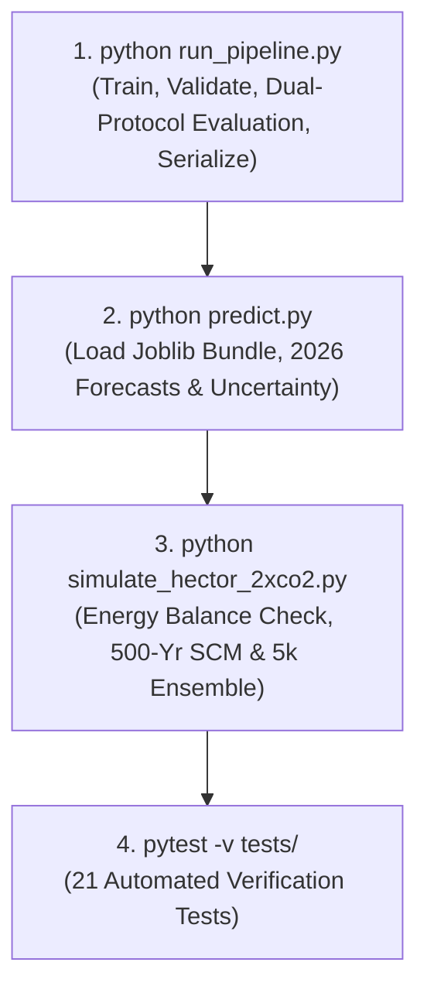

# End-to-End Reproducibility Guide

## Investigating Climate Sensitivity Under 2×CO₂: From Raw Data to Verification

---

### 1. System Requirements & Hardware Specifications

- **Operating System:** Windows 10/11, Ubuntu 20.04+, or macOS 12+ (cross-platform compatible).
- **Python Version:** Python 3.10, 3.11, 3.12, 3.13, or 3.14.
- **Hardware Resources:**
  - Minimum 4 GB RAM (8 GB recommended for the 5,000-member Monte Carlo ensemble).
  - ~150 MB free disk space (datasets, model bundles, plots, and virtual environment).
  - Runtime: Total end-to-end execution of all pipelines, simulations, and tests completes in under **60 seconds** on standard modern CPUs.

---

### 2. Clean Environment Setup

#### Step 2.1: Open Terminal / Shell
Navigate to the root directory of the project:
```bash
cd c:\Users\bharg\OneDrive\Desktop\ml_model
```

#### Step 2.2: Create and Activate an Isolated Virtual Environment
On Windows (PowerShell or Command Prompt):
```powershell
python -m venv test_env
test_env\Scripts\activate
```

On Linux or macOS:
```bash
python3 -m venv test_env
source test_env/bin/activate
```

#### Step 2.3: Install Pinned Dependencies
Install all verified package versions using `requirements.txt`:
```bash
pip install -r requirements.txt
```

Verify installed versions match expectations:
```bash
python -c "import numpy, pandas, scipy, sklearn, xgboost, matplotlib, joblib, pytest; print('All dependencies imported successfully!')"
```

---

### 3. Step-by-Step Execution Workflow

To reproduce the entire scientific trajectory from scratch, execute the following four commands in sequence:



---

#### Step 3.1: Execute Empirical Modeling Pipeline (`run_pipeline.py`)

```bash
python run_pipeline.py
```

**What This Step Does:**
1. Loads and validates raw archives (`co2_mm_mlo.csv` and `gistemp_monthly.csv`).
2. Constructs the 814-month paired ground-truth dataset (`climate_paired.csv`).
3. Computes 9 anti-leakage features over 801 valid months (1959-04 to 2025-12).
4. Fits and tunes models on Training (1959–2005) and Validation (2006–2015) sets.
5. Evaluates both **Protocol A (1-step teacher forced)** and **Protocol B (10-year recursive rollout)** on the untouched 2016–2025 test window.
6. Serializes the best-performing model bundle to `modeling_outputs/ridge_climate_model.joblib`.
7. Saves the comparison table to `modeling_outputs/evaluation_protocols_comparison.csv`.

**Expected Terminal Output Snippet:**
```
================================================================================
CLIMATE SENSITIVITY MODELING PIPELINE & DUAL-PROTOCOL EVALUATION
================================================================================
Paired dataset: 814 months (1958-03 to 2025-12)
Valid feature matrix: 801 months (1959-04 to 2025-12)
Training: 561 months | Validation: 120 months | Test: 120 months

Out-of-Sample Test Evaluation Summary (2016-01 to 2025-12):
+-------------------------------+-----------------------+----------+---------+
| Model                         | Protocol              | RMSE (°C)| R²      |
+-------------------------------+-----------------------+----------+---------+
| Ridge Regression (alpha=0.01) | 1-Step Teacher-Forced | 0.1124   | +0.6532 |
| Ridge Regression (alpha=0.01) | 10-Yr Recursive       | 0.1754   | +0.1555 |
| Naive Persistence (Lag-1)     | 1-Step Teacher-Forced | 0.1179   | +0.6186 |
| Naive Persistence (Lag-1)     | 10-Yr Recursive       | 0.2453   | -0.6517 |
| Seasonal Persistence (Lag-12) | 1-Step Teacher-Forced | 0.2082   | -0.1898 |
| Seasonal Persistence (Lag-12) | 10-Yr Recursive       | 0.2485   | -0.6951 |
+-------------------------------+-----------------------+----------+---------+
Model bundle serialized to: modeling_outputs/ridge_climate_model.joblib
Comparison saved to: modeling_outputs/evaluation_protocols_comparison.csv
```

---

#### Step 3.2: Execute Inference & 2026 Projections (`predict.py`)

```bash
python predict.py
```

**What This Step Does:**
1. Deserializes `modeling_outputs/ridge_climate_model.joblib`.
2. Inspects model weights, hyperparameters, and validation residual standard error ($\sigma_{\text{val}} = 0.11109^\circ\text{C}$).
3. Ingests measured 2026 NOAA $\text{CO}_2$ observations (Jan–Sep 2026).
4. Calculates recursive autoregressive prediction intervals: $\sigma(h) = \sigma_{\text{val}} \sqrt{\sum \psi_j^2}$.
5. Saves projections to `modeling_outputs/projected_anomalies_2026.csv`.

**Expected Terminal Output Snippet:**
```
================================================================================
CLIMATE SENSITIVITY MODEL INFERENCE & SCIENTIFIC PROJECTION VERIFICATION
================================================================================
Model Architecture: Ridge Regression | alpha: 0.01
Target Variable:    temp_anomaly_c (NASA GISS 1951-1980 baseline (°C))

Out-of-Sample 2026 Projections (Driven by Measured 2026 NOAA CO₂):
Month      NOAA CO₂ (ppm)   Forecast (°C)   95% Conf. Interval       Status
--------------------------------------------------------------------------------
2026-01    428.62              +1.093 °C       [+0.875°C, +1.310°C]     Statistical Projection
2026-05    432.34              +1.020 °C       [+0.750°C, +1.292°C]     Statistical Projection
2026-09    426.07              +0.981 °C       [+0.703°C, +1.259°C]     Statistical Projection
Projections saved to: modeling_outputs/projected_anomalies_2026.csv
```

---

#### Step 3.3: Execute Physical Climate Simulation (`simulate_hector_2xco2.py`)

```bash
python simulate_hector_2xco2.py
```

**What This Step Does:**
1. Solves the 1D ocean diffusion energy-balance equations (DOECLIM).
2. Performs automated energy conservation verification (residual error $< 10^{-10}\%$).
3. Verifies time-step numerical convergence between $\Delta t = 1.0\text{ yr}$ and $\Delta t = 0.1\text{ yr}$.
4. Runs deterministic multi-century benchmarks (Low, Central, High ECS).
5. Runs the 5,000-member Monte Carlo prior parameter uncertainty ensemble.
6. Contrasts physical SCM multi-century uptake against empirical ML rollout.
7. Generates 4 publication figures and saves `hector_outputs/hector_2xco2_ensemble_summary.csv`.

**Expected Terminal Output Snippet:**
```
================================================================================
PHASE 7: PHYSICAL CLIMATE SIMULATION ENGINE (DOECLIM / HECTOR SCM FRAMEWORK)
================================================================================
Energy Conservation Check (Year 100):
  Integrated TOA Heat Uptake (E_in):  2.461621e+24 J
  Total Ocean Heat Content (ΔOHC):   2.461621e+24 J
  Relative Energy Residual:          5.452412e-13%
  Status: PASSED (Machine Precision Energy Conservation)

Numerical Time-Step Convergence Check (Year 100):
  Δt = 1.0 yr:  T = 1.78356 °C
  Δt = 0.1 yr:  T = 1.78585 °C (Difference: 0.00230 °C)
  Convergence Tolerance (< 0.01°C): PASSED

TIER 2: PROBABILISTIC MONTE CARLO ENSEMBLE (N = 5,000)
Executing Monte Carlo simulation over 500 years...
Ensemble execution complete!
Year 10 : Median = 0.73°C | Year 70 : Median = 1.58°C | Year 500: Median = 2.32°C
Generated: hector_outputs/01_hector_probabilistic_plume_500yr.png
Generated: hector_outputs/02_physical_scm_vs_empirical_ml_2xco2.png
Generated: hector_outputs/03_ocean_heat_and_planetary_imbalance.png
Generated: hector_outputs/04_transient_climate_response_1pct.png
```

---

#### Step 3.4: Execute Automated Test Suite (`pytest`)

```bash
pytest -v tests/
```

**Expected Terminal Output Snippet:**
```
============================= test session starts =============================
platform win32 -- Python 3.14.0, pytest-9.2.0, pluggy-1.7.0
collected 21 items

tests/test_data_preprocessing.py::test_raw_files_exist PASSED            [  4%]
tests/test_data_preprocessing.py::test_paired_dataset_structure PASSED   [  9%]
tests/test_data_preprocessing.py::test_no_missing_or_duplicate_dates PASSED [ 14%]
tests/test_data_preprocessing.py::test_physical_variable_ranges PASSED   [ 19%]
tests/test_feature_engineering.py::test_feature_matrix_integrity PASSED  [ 23%]
tests/test_feature_engineering.py::test_required_feature_columns PASSED  [ 28%]
tests/test_feature_engineering.py::test_zero_future_leakage PASSED       [ 33%]
tests/test_feature_engineering.py::test_chronological_splits PASSED      [ 38%]
tests/test_model_pipeline.py::test_comparison_csv_exists_and_structure PASSED [ 42%]
tests/test_model_pipeline.py::test_protocol_a_teacher_forced_hierarchy PASSED [ 47%]
tests/test_model_pipeline.py::test_protocol_b_recursive_rollout_hierarchy PASSED [ 52%]
tests/test_model_serialization.py::test_model_artifact_exists PASSED     [ 57%]
tests/test_model_serialization.py::test_model_bundle_contents PASSED     [ 61%]
tests/test_model_serialization.py::test_inference_prediction_shape_and_range PASSED [ 66%]
tests/test_model_serialization.py::test_prediction_interval_propagation PASSED [ 71%]
tests/test_model_serialization.py::test_projected_anomalies_2026_file PASSED [ 76%]
tests/test_physical_simulation.py::test_hector_ensemble_summary_exists PASSED [ 80%]
tests/test_physical_simulation.py::test_doeclim_energy_conservation_and_asymptote PASSED [ 85%]
tests/test_physical_simulation.py::test_transient_climate_response_less_than_ecs PASSED [ 90%]
tests/test_physical_simulation.py::test_doeclim_energy_conservation_precision PASSED [ 95%]
tests/test_physical_simulation.py::test_doeclim_time_step_convergence PASSED [100%]

============================= 21 passed in 1.97s ==============================
```

---

### 4. Output Artifact Verification Checklist

After running the workflow, verify that all expected output files exist with non-zero size:

| Output Artifact Path | Required File | Expected Shape / Content |
|---|---|---|
| `climate_paired.csv` | Yes | 814 rows, 4 columns (`year`, `month`, `co2_ppm`, `temp_anomaly_c`) |
| `modeling_outputs/ridge_climate_model.joblib` | Yes | Serialized Joblib bundle with model, coefs, intercept, metrics |
| `modeling_outputs/evaluation_protocols_comparison.csv` | Yes | 6 rows, Protocol A vs Protocol B metrics for 3 models |
| `modeling_outputs/projected_anomalies_2026.csv` | Yes | 9 rows (2026-01 to 2026-09), forecast and 95% CIs |
| `hector_outputs/hector_2xco2_ensemble_summary.csv` | Yes | 501 rows (Years 0–500), ensemble percentiles & deterministic runs |
| `hector_outputs/01_hector_probabilistic_plume_500yr.png` | Yes | 500-year probabilistic warming plume plot |
| `hector_outputs/02_physical_scm_vs_empirical_ml_2xco2.png` | Yes | SCM vs. ML failure modes comparison plot |
| `hector_outputs/03_ocean_heat_and_planetary_imbalance.png` | Yes | Top-of-atmosphere imbalance & ocean heat uptake |
| `hector_outputs/04_transient_climate_response_1pct.png` | Yes | TCR at Year 70 under 1pctCO2 protocol |

